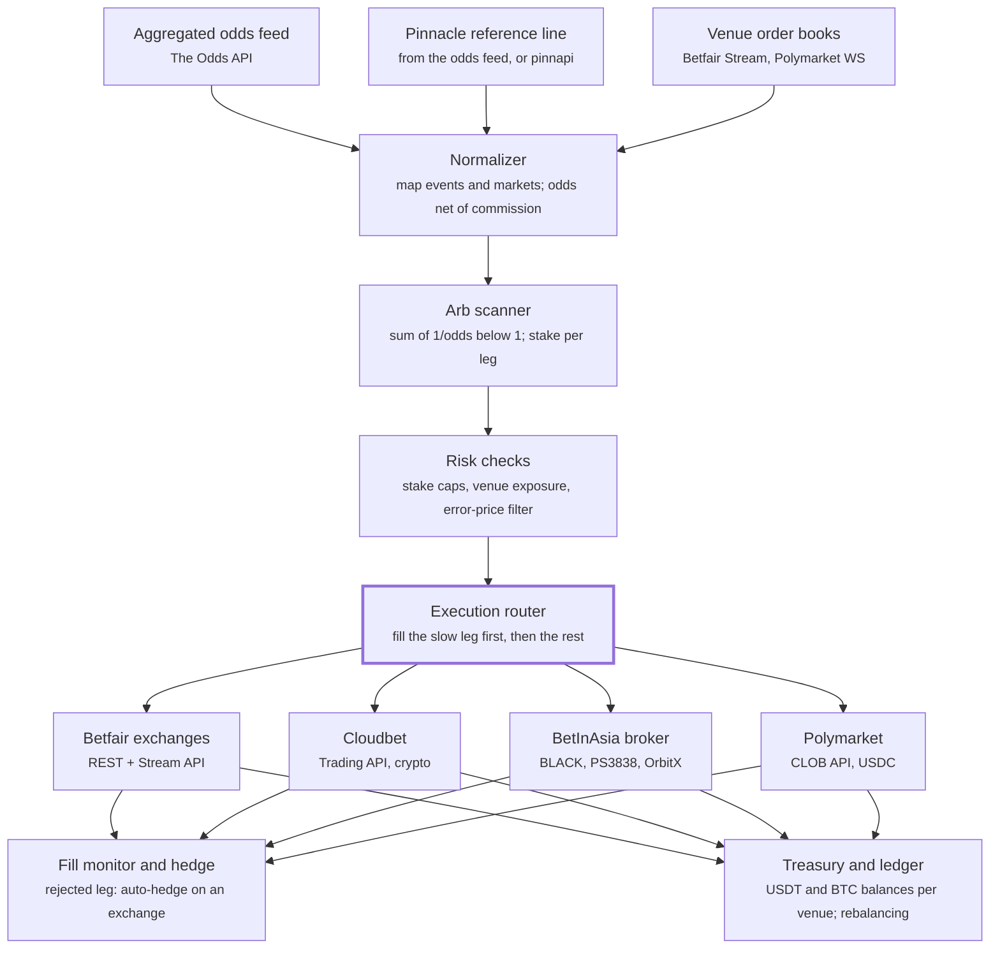

# System architecture

The product is a pipeline much like a market-making stack: normalized feeds in, a scanner, risk checks, and one router that owns every order.

The 30-day test runs only the read-only half: feeds, normalizer, scanner and risk checks, writing to a log and the paper trader ([scanner](09-scanner.md)). The execution router, hedge loop and treasury are built only after a go on every gate ([getting started](07-getting-started.md)).

## Components

| Component | Responsibility |
| --- | --- |
| Feeds | Aggregated odds for detection; Pinnacle as fair-price anchor; venue order books for live depth |
| Normalizer | Map the same match / market / selection across venues; convert to decimal odds net of commission |
| Arb scanner | Compute `Σ 1/o_i`, flag `< 1`, size each leg |
| Risk checks | Per-arb stake caps, per-venue exposure limits, reject suspicious (error) prices |
| Execution router | Places legs; fills the leg most likely to move or reject first |
| Fill monitor and hedge | Watches fills; if a leg fails, hedges the open position on an exchange |
| Treasury and ledger | Tracks USDT / BTC balances per venue, P&L, and rebalancing |

The router is where profit is won or lost: it fills the leg most likely to move or reject first, and the hedge loop covers any leg that fails.
