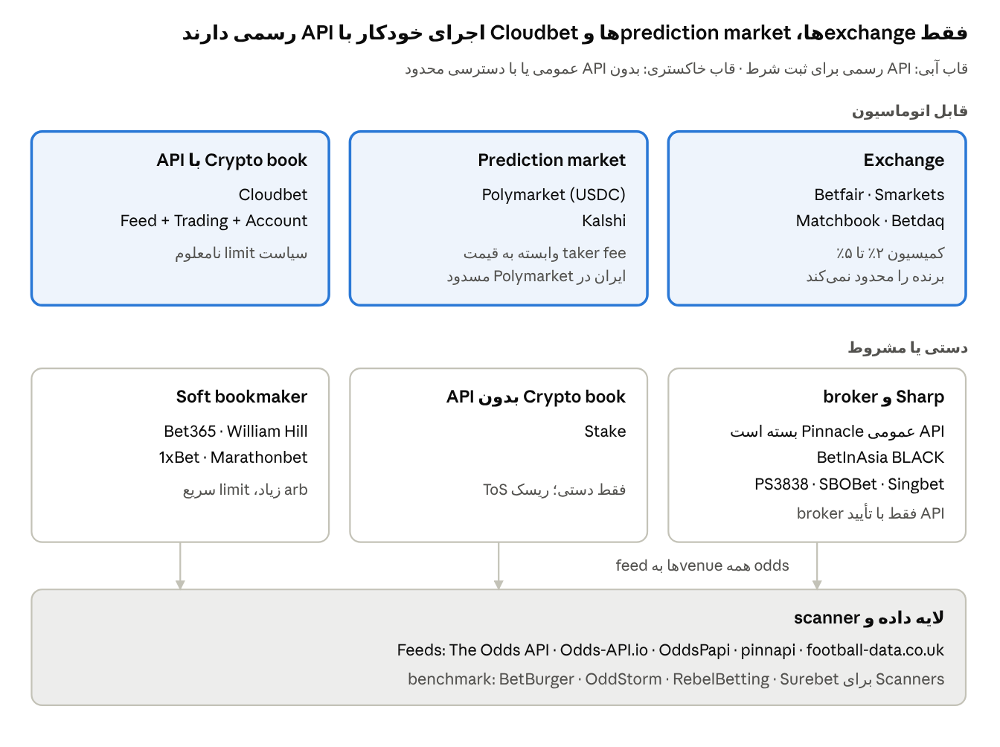
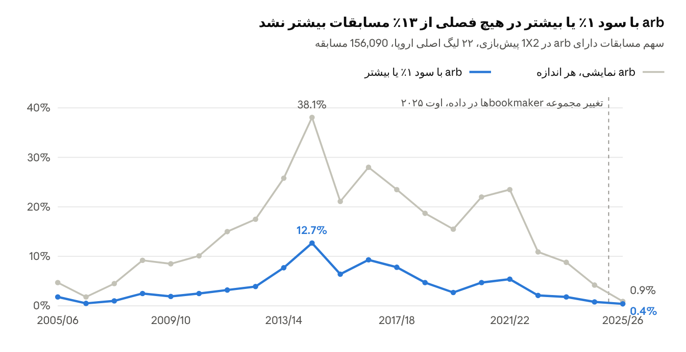
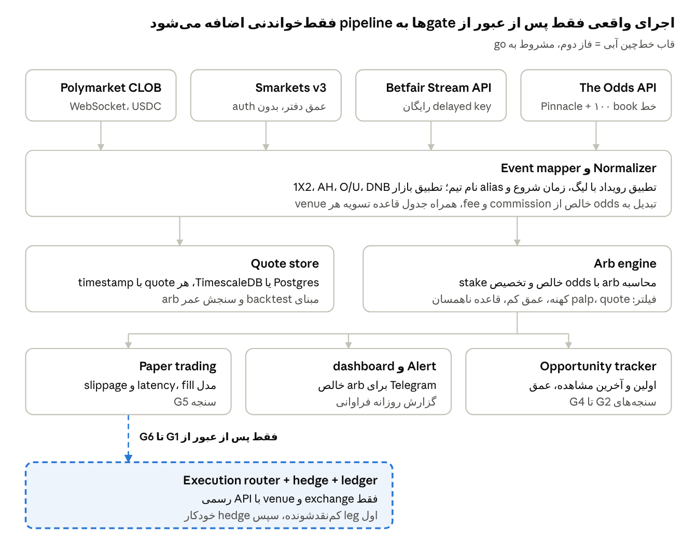
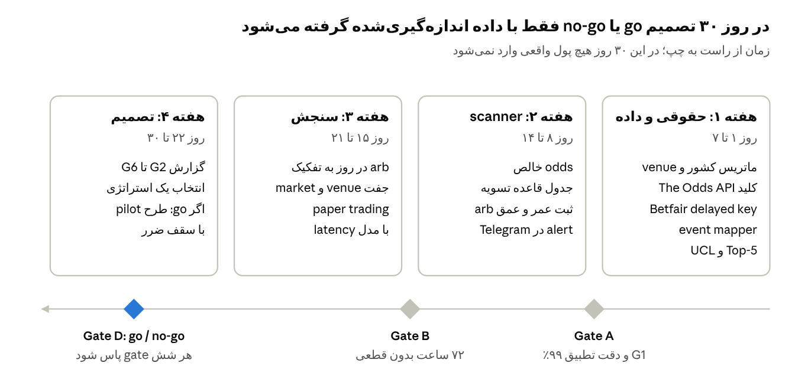

# گزارش تحقیق آربیتراژ شرط‌بندی ورزشی

۲۱ اکتبر ۲۰۲۶ · Sobi · [نسخه زنده و قابل ویرایش در Claude Docs](https://claude.ai/artifact/MJ8gAsBwW7Vn4mUkBsxcLW)

## خلاصه اجرایی

آربیتراژ «نمایشی» در فوتبال زیاد دیده می‌شود، اما آربیتراژ خالص و قابل اجرا روی venueهایی که API دارند و برنده‌ها را محدود نمی‌کنند نادر و کم‌حاشیه است. توصیه: هیچ استقرار live نکنید؛ ۳۰ روز scanner فقط‌خواندنی روی exchangeها اجرا کنید و با معیارهای go/no-go همین سند تصمیم بگیرید.

| یافته | عدد | نوع شاهد |
| --- | --- | --- |
| شرط صفر حقوقی | اگر اپراتور مقیم ایران باشد، اجرای واقعی No-Go است (ممنوعیت قمار + تحریم؛ Polymarket ایران را کامل مسدود کرده) | Verified + منبع ثانویه |
| فراوانی arb نمایشی، ۲۲ لیگ اروپایی، ۲۰۲۲–۲۴ | ۹.۸٪ مسابقات در snapshot پیش‌بازی Σ(1/max) < 1 داشتند؛ میانه ROI فقط ۰.۴۳٪ | Measured (۱۵,۱۱۶ مسابقه) |
| arbهای ≥۱٪ در همان نمونه | ۱.۹۵٪ مسابقات؛ ≥۲٪ فقط ۰.۴۹٪ | Measured |
| فصل ۲۰۲۵/۲۶ (مجموعه bookmaker کوچک‌تر در داده) | ۰.۹٪ مسابقات arb؛ ۰.۴٪ با ROI ≥۱٪ | Measured |
| لیگ‌های کوچک‌تر | arb کمتر، نه بیشتر: Top-5 ۲۸.۴٪ در برابر ۲.۹–۵.۱٪ برای دسته‌های پایین‌تر (1X2، ۲۰۲۲–۲۴) | Measured |
| نمونه زنده امروز: Bayern–Arsenal، Smarkets در برابر Polymarket | arb ناخالص +۰.۱۲٪ تا +۱.۱۴٪؛ پس از commission و fee همه منفی: −۰.۶۱٪ تا −۱.۵۱٪ | Measured (۰۹:۰۶ UTC) |
| arb بین soft bookmaker و exchange | ۱۹.۲٪ مسابقات Top-5 با میانگین ۱.۴٪ (۲۰۰۴–۲۰۱۱)؛ اما soft bookها API ندارند و حساب برنده را ظرف چند ماه محدود می‌کنند | مطالعه داوری‌شده + گزارش تجربی |

بهترین فرضیه برای آزمون اول: arb دوطرفه (O/U، Asian Handicap، Draw No Bet، BTTS و back/lay) در Top-5 و Champions League بین Betfair، Smarkets، Matchbook و Polymarket، با خط Pinnacle به‌عنوان قیمت مرجع. اجرای تمام‌خودکار فقط روی exchangeها شدنی است؛ برای بقیه، سیستم alert با hedge نیمه‌خودکار واقع‌بینانه‌تر است.

## دامنه، روش و برچسب شواهد

هر عدد در این سند یکی از چهار برچسب زیر را دارد تا داده اندازه‌گیری‌شده با ادعا یا تخمین قاطی نشود.

| برچسب | معنی | نمونه در این سند |
| --- | --- | --- |
| Measured | خودم از داده خام محاسبه کردم؛ کد و ورودی قابل تکرار است | ۲۱۱,۲۱۰ مسابقه دارای max odds از mirror داده football-data.co.uk؛ quoteهای زنده Smarkets و Polymarket |
| Verified | از صفحه رسمی همان پلتفرم در ۲۱ اکتبر ۲۰۲۶ خوانده شد | Betfair live key £499، fee ورزشی Polymarket، بسته شدن API عمومی Pinnacle |
| Third-party | بررسی یا مقایسه منتشرشده توسط دیگران (اغلب رقیب یا affiliate) | قیمت scannerها، دسترسی BetInAsia |
| Estimate | فرض صریح من، برای برنامه‌ریزی؛ باید با داده ۳۰ روزه جایگزین شود | سرمایه pilot، آستانه‌های go/no-go |

روش در سه لایه بود:

1. نقشه venueها و APIها از مستندات رسمی و بررسی‌های ۲۰۲۶.
2. سنجش تاریخی: Σ(1/max odds) برای 1X2 و Over/Under 2.5 در ۲۲ لیگ اصلی اروپا (۱۵۶,۷۴۴ مسابقه، ۲۰۰۵ تا سپتامبر ۲۰۲۶) و ۱۶ لیگ «extra» با فایل متفاوت که جدا گزارش شد.
3. snapshot زنده: quoteهای Smarkets (API عمومی v3) و Polymarket (Gamma API) برای یک مسابقه Champions League امشب، محاسبه‌شده خالص از commission و fee.

محدودیت مهم داده تاریخی: max odds در یک لحظه (جمعه یا سه‌شنبه بعدازظهر) ثبت شده و از bookmakerهای مختلف می‌آید؛ پس هم arbهای کوتاه‌عمر بین دو snapshot را نمی‌بیند (کم‌شماری) و هم قیمت‌های stale، اشتباه یا محدودشده را arb حساب می‌کند (بیش‌شماری). این عدد سقف «نمایشی» است، نه سود قابل برداشت.

## وضعیت حقوقی و واجد شرایط بودن اپراتور

پیش از هر تحلیل سود، کشور اقامت و ثبت اپراتور تعیین‌کننده است. اگر اپراتور مقیم ایران باشد، اجرای شرط واقعی No-Go است و پروژه فقط در حد پژوهش داده و نرم‌افزار ادامه می‌یابد. این بخش نظر حقوقی نیست؛ پیش از باز کردن هر حساب، نظر وکیل محلی لازم است.

| حوزه قضایی اپراتور | آنچه پیدا شد | پیامد برای پروژه | اعتبار شاهد |
| --- | --- | --- | --- |
| ایران | قمار از ۱۹۷۹ ممنوع است؛ ماده ۷۰۵ قانون مجازات اسلامی برای قمار غیرقانونی حبس و شلاق تعیین می‌کند؛ ۲۰۲۴ شبکه «Nitro Bet» توسط وزارت اطلاعات منحل شد ([SiGMA](https://sigma.world/news/iran-cracks-down-on-illegal-gambling-activities/)) | اجرای واقعی: No-Go. Polymarket ایران را کامل مسدود کرده، حتی برای بستن پوزیشن ([Polymarket geoblock](https://docs.polymarket.com/api-reference/geoblock.md)). فهرست‌های ثانویه ایران را برای Betfair هم محدود نشان می‌دهند | Polymarket: Verified · قانون: منبع ثانویه |
| تاجیکستان | شرط‌بندی ورزشی فقط با مجوز وزارت دارایی قانونی است؛ کازینوی آنلاین و crypto gambling ممنوع؛ دور زدن مسدودسازی با VPN هم غیرقانونی ([gamblingmaps](https://gamblingmaps.org/map/regulations/tajikistan)) | venueهای offshore و پرداخت crypto احتمالاً مجاز نیستند؛ تأیید وکیل محلی شرط ورود است | ضعیف: خود منبع می‌گوید «AI overview تأییدنشده» |
| کشور ثالث (اقامت یا شرکت) | هر venue فهرست کشور ممنوع جدا دارد؛ مثلاً Polymarket برای UK، US، France، Germany فقط close-only است | قبل از طراحی، ماتریس «کشور × venue» را از ToS رسمی هر venue پر کنید | Verified برای Polymarket |

خط قرمزهای این سند، بدون استثنا: بدون VPN برای دور زدن geo-block، بدون KYC نادرست، بدون حساب به نام دیگران (beard / bet broker غیررسمی)، و اتوماسیون فقط از طریق API رسمی. سطح حساب و limitها را با فریب دور نمی‌زنیم.

## نقشه بازیگران

بازار به دو نیمه تقسیم می‌شود: venueهایی که API رسمی ثبت شرط دارند و برنده را تحمل می‌کنند، و venueهایی که arb بیشتری می‌سازند اما فقط دستی یا مشروط قابل استفاده‌اند.



<sub>نقشه بازیگران · ۶ گروه venue + لایه داده · وضعیت ۲۱ اکتبر ۲۰۲۶</sub>

محصول باید با ردیف بالا کار کند اگر همه soft bookها از دست بروند؛ ردیف پایین فقط منبع قیمت مرجع یا اجرای دستی است.

## پایگاه داده APIها و محدودیت‌ها

فقط exchangeها، Cloudbet و Polymarket API عمومی برای ثبت شرط دارند؛ Pinnacle از ۲۳ ژوئیه ۲۰۲۵ API عمومی را بسته است. برای داده، The Odds API ارزان‌ترین گزینه‌ای است که هم Pinnacle و هم Betfair Exchange، Matchbook، Smarkets و Polymarket را پوشش می‌دهد.

### Execution: جایی که می‌شود با API شرط بست

| Venue | نوع | API ثبت شرط | دسترسی و هزینه | Commission / fee | Crypto | محدودیت کلیدی | شاهد |
| --- | --- | --- | --- | --- | --- | --- | --- |
| [Betfair Exchange](https://support.developer.betfair.com/hc/en-us/articles/115003864651-How-do-I-get-started) | Exchange | REST + Stream | Delayed key رایگان؛ live key یک‌باره £499 پس از KYC | UK/IE: ۵٪ (Rewards)، ۲٪ (Basic)، ۸٪ (Rewards+) روی سود خالص ([Sporting Life](https://www.sportinglife.com/free-bets/guides/betfair-exchange-education/how-does-commission-work)) | ندارد | delayed key با تأخیر ۱ تا ۱۸۰ ثانیه | Verified |
| [Smarkets](https://footballgroundguide.com/betting/smarkets) | Exchange | v3 REST؛ trading با تأیید | خواندن عمومی بدون auth (امروز تست شد)؛ trading با فرم درخواست | ۲٪ روی سود خالص هر market | ندارد | کاربران API از promo صفر commission مستثنا | Measured + Third-party |
| [Matchbook](https://sportsapis.dev/betting-exchange-api) | Exchange | REST | هر مشتری ثبت‌نام‌شده؛ بالاتر از سقف پیش‌فرض £100 به ازای هر ۱ میلیون GET | ۲٪ روی همه ورزش‌ها از اوت ۲۰۱۹ ([SBC](https://sbcnews.co.uk/europe/2019/08/07/matchbook-sticks-at-2-commission-on-all-sports/)) | ندارد | نقدشوندگی کمتر از Betfair | Third-party |
| Betdaq | Exchange | API v2 | فرم درخواست + حساب تأییدشده | تأیید نشد | ندارد | دفتر سفارش کوچک‌تر | Third-party |
| [Polymarket](https://docs.polymarket.com/trading/fees?via=xp) | Prediction market (CLOB) | CLOB، wallet-based | خواندن عمومی رایگان (امروز تست شد) | Sports: taker fee = 0.05 × p × (1−p) به ازای هر share؛ maker صفر + rebate ۱۵٪ | USDC | ایران مسدود؛ UK، US، FR، DE close-only؛ tick ۰.۰۱؛ حداقل سفارش ۵ share | Verified + Measured |
| Kalshi | Event-contract exchange | REST، WebSocket، FIX | کلید self-serve | taker fee وابسته به قیمت (تأیید نشد) | تأیید نشد | دسترسی بین‌المللی فقط وب و ناپایدار ([Sportico](https://www.sportico.com/business/sports-betting/2025/kalshi-international-countries-access-1234874388/)) | Third-party |
| [Cloudbet](https://www.cloudbet.com/api/) | Crypto sportsbook | Feed + Trading + Account | کلید از داخل حساب | margin داخل قیمت | بله | فهرست کشور ممنوع و پوشش فعلی Trading API تأیید نشد | Verified (خلاصه رسمی) |
| [Pinnacle](https://github.com/pinnacleapi/pinnacleapi-documentation) | Sharp book | API عمومی بسته از ۲۳ ژوئیه ۲۰۲۵ | فقط bespoke برای bettorهای پرارزش و شرکا، با ایمیل به api@pinnacle.com | margin پایین | BTC | دسترسی عملی از طریق broker | Verified |
| [BetInAsia BLACK](https://www.vip-grinders.com/best-bookmakers/betinasia-review/) | Broker | Sports Betting API فقط برای کاربران تأییدشده | درخواست از support | Betfair تا ۵٪؛ OrbitX متغیر | BTC، USDT، ETH | ممنوع: FR، DE، UK، US؛ وضعیت ایران و تاجیکستان ذکر نشده | Third-party (به‌روز ۹ فوریه ۲۰۲۶) |
| Stake | Crypto sportsbook | ندارد | فقط دستی | margin | بله | اتوماسیون = ریسک ToS | Third-party |
| Novig، ProphetX، Sporttrade | US exchanges | API عمومی ندارند | — | — | — | فقط آمریکا | Third-party |

### Data: odds feedها و داده تاریخی

| Provider | پوشش | Sharp / exchange در پوشش | قیمت | Streaming | Historical | شاهد |
| --- | --- | --- | --- | --- | --- | --- |
| [The Odds API](https://the-odds-api.com/sports-odds-data/bookmaker-apis.html) | بیش از ۱۰۰ bookmaker در regionهای uk، eu، us، au، us\_ex | Pinnacle، Betfair Ex (uk/eu/au)، Matchbook، Smarkets، 1xBet، Marathonbet، Polymarket، Kalshi | رایگان ۵۰۰ credit؛ $30 (20k)؛ $59 (100k)؛ $119 (5M)؛ $249 (15M) | فقط polling | از ۲۰۲۰، پلن پولی، ۱۰× credit | Verified |
| [Odds-API.io](https://odds-api.io/) | ۴۱۵+ bookmaker، ۳۴ ورزش | Betfair Exchange، Polymarket | £49 (۲ bookmaker) تا £229 (۱۵)؛ کلید رایگان فعلاً متوقف | WebSocket با هزینه برابر پلن | تأیید نشد | Verified |
| [OddsPapi](https://oddspapi.io/en) | ۳۰۰ تا ۳۵۰+ | Pinnacle، Betfair، SBOBet، Stake | رایگان ۲۵۰ درخواست در ماه؛ پولی سفارشی | WebSocket فقط پولی | رایگان | Verified (سایت خودش) |
| [pinnapi](https://sportsapis.dev/apis/pinnapi) | فقط Pinnacle | خط مرجع Pinnacle | رایگان ۱۰۰ درخواست در روز؛ $99 تا $229؛ WS +$99 | SSE، WS | — | Third-party؛ ToS بازنشر نامعلوم |
| SportsGameOdds | ۸۵+ | تأیید نشد | $99 تا $499 | WS در enterprise | دارد | بلاگ خود vendor |
| OpticOdds | ۲۰۰+ | تأیید نشد | حدود $5,000 در ماه (گزارش‌شده) | SSE | — | Third-party |
| [football-data.co.uk](https://www.football-data.co.uk/notes.txt) | ۲۰+ لیگ اروپا + لیگ‌های extra | ستون‌های Pinnacle، Betfair Ex، Max، Avg و closing | رایگان | — | از ۲۰۰۰ | Verified |

هزینه credit در The Odds API برابر markets × regions در هر فراخوانی است و historical ده برابر ([OddsPapi](https://oddspapi.io/blog/the-odds-api-free-tier-limits)). یک ادعای رقیب که The Odds API «Pinnacle و Betfair Exchange ندارد» با فهرست رسمی bookmakerها رد می‌شود.

### Scannerهای آماده (برای benchmark، نه برای ساختن روی آن‌ها)

| Scanner | قیمت ماهانه | سرعت اعلام‌شده | نسخه رایگان |
| --- | --- | --- | --- |
| BetBurger | Prematch €79.99؛ Live €279.99؛ هر دو €319.99 | refresh هر ۲.۵ تا ۴ ثانیه | تأخیر تا ۶۰ ثانیه، سقف ۱٪ |
| OddStorm | €155 تا €390 | live ۱ تا ۳ ثانیه؛ prematch حدود ۱۵ ثانیه | — |
| RebelBetting | €69 / €139، فقط prematch | — | ۱۴ روز آزمایشی |
| Surebet.com | €25.90 تا €27.90، فقط prematch | — | رایگان با سقف حدود ۱٪ |
| BreakingBet | حدود €25 هر بخش | live حدود ۲۵ ثانیه تأخیر | دارد |

منبع جدول scannerها یک بررسی Third-party از سپتامبر ۲۰۲۵ است ([sportsgamblingpodcast](https://www.sportsgamblingpodcast.com/2025/09/24/overview-of-the-top8-arbitrage-betting-scanners/)) و برای هیچ‌کدام API عمومی ذکر نشده؛ قیمت‌ها را پیش از خرید روی سایت رسمی چک کنید.

## شواهد کمّی: فراوانی آربیتراژ تاریخی

در ۲۲ لیگ اصلی اروپا، arb نمایشی در 1X2 پیش‌بازی از ۳۸.۱٪ مسابقات (۲۰۱۴/۱۵) به ۰.۹٪ (۲۰۲۵/۲۶) رسید و arb با ROI ≥۱٪ در هیچ فصلی از ۱۲.۷٪ بیشتر نبود. میانه ROI arbهای ۲۰۲۲–۲۴ فقط ۰.۴۳٪ بود؛ یعنی بیشتر arbهای نمایشی کوچک‌تر از هزینه یک exchange هستند.



<sub>Measured · mirror football-data.co.uk (xgabora/Club-Football-Match-Data-2000-2025) · ۲۲ لیگ اصلی اروپا · snapshot جمعه/سه‌شنبه</sub>

بالا رفتن تا ۲۰۱۴ و افت پس از ۲۰۲۲ هم به کارایی بازار و هم به تعداد bookmakerهای داخل ستون Max بستگی دارد؛ جهش اوت ۲۰۲۵ هم‌زمان در همه لیگ‌ها رخ داد و با تغییر منبع داده سازگار است، پس ۰.۹٪ آخر را با فصل‌های قبل مقایسه مستقیم نکنید.

### بر اساس سطح لیگ، فصل‌های ۲۰۲۲/۲۳ و ۲۰۲۳/۲۴

| سطح لیگ | مسابقات | 1X2: arb نمایشی | 1X2: ROI ≥ ۱٪ | میانه ROI arbها | O/U 2.5: arb نمایشی | O/U 2.5: ROI ≥ ۱٪ |
| --- | --- | --- | --- | --- | --- | --- |
| Top-5 (E0، D1، I1، SP1، F1) | ۳,۵۷۸ | ۲۸.۴٪ | ۴.۹٪ | ۰.۳۹٪ | ۴.۱٪ | ۰.۸٪ |
| دسته دوم Top-5 (E1، D2، I2، SP2، F2) | ۴,۱۵۷ | ۴.۶٪ | ۰.۸٪ | ۰.۴۱٪ | ۱.۴٪ | ۰.۴٪ |
| لیگ اول دیگر اروپا (N1، P1، B1، T1، G1، SC0) | ۲,۹۹۱ | ۵.۱٪ | ۱.۳٪ | ۰.۴۹٪ | ۳.۳٪ | ۰.۶٪ |
| دسته‌های پایین انگلیس و اسکاتلند | ۴,۳۹۰ | ۲.۹٪ | ۱.۰٪ | ۰.۶۲٪ | ۱.۱٪ | ۰.۳٪ |
| لیگ‌های extra (ARG، BRA، USA، JAP و…؛ فایل متفاوت) | ۹,۳۵۵ | ۳۴.۴٪ | ۱۷.۸٪ | ۱.۰۵٪ | — | — |

همین الگو در پژوهش داوری‌شده هم دیده می‌شود. Franck، Verbeek و Nüesch با ۱۰ bookmaker و Betfair در Top-5 (۲۰۰۴/۰۵ تا ۲۰۱۰/۱۱، ۱۱,۹۳۳ مسابقه) arb فقط بین bookmakerها را در ۰.۸٪ مسابقات با میانگین ۰.۹٪ یافتند؛ اما ترکیب back در bookmaker و lay در Betfair (با commission ۵٪) در ۱۹.۲٪ مسابقات با میانگین ۱.۴٪ رخ داد. با بدترین قیمت Betfair این عدد به ۱.۳٪ افت کرد، که نشان می‌دهد عمق و قیمت واقعی exchange چقدر تعیین‌کننده است ([Franck et al. 2013](https://unifr.ch/tim/en/assets/public/uploads/Publication%20list/2013/Franck_Verbeek_N%C3%BCesch_2013.pdf)).

## نمونه واقعی با odds زمان‌دار: Bayern–Arsenal

امروز بین Smarkets و Polymarket سه arb ناخالص پیدا شد (تا +۱.۱۴٪)، اما هر سه پس از commission ۲٪ و taker fee پلی‌مارکت منفی شدند (بهترین: −۰.۶۱٪). این همان فاصله «تفاوت قیمت نمایشی» با «arb قابل اجرا» است.

مسابقه: Bayern Munich در برابر Arsenal، Champions League، شروع ۲۱ اکتبر ۲۰۲۶ ساعت ۱۹:۰۰ UTC. Quoteهای Smarkets از `api.smarkets.com/v3` حدود ۰۹:۰۶ UTC (event 45379705) و Polymarket از Gamma API حدود ۰۹:۰۷ UTC (event `ucl-bay-ars-2026-10-21`) خوانده شد. قیمت Smarkets بر حسب basis point احتمال است: 4587 یعنی ۴۵.۸۷٪ یعنی decimal 2.180.

| پیامد | Smarkets back (offer) | Smarkets lay (bid) | Polymarket YES ask | Polymarket YES bid |
| --- | --- | --- | --- | --- |
| Bayern | ۴۵.۸۷٪ = 2.180 | ۴۵.۴۵٪ = 2.200 | 0.48 | 0.47 |
| Draw | ۲۵.۰۰٪ = 4.000 | ۲۴.۳۹٪ = 4.100 | 0.25 | 0.24 |
| Arsenal | ۲۹.۸۵٪ = 3.350 | ۲۹.۴۱٪ = 3.400 | 0.29 | 0.28 |
| Over 2.5 | ۶۳.۲۹٪ = 1.580 | ۶۲.۱۱٪ = 1.610 | 0.62 | 0.60 |
| Under 2.5 | ۳۷.۸۸٪ = 2.640 | ۳۶.۷۶٪ = 2.720 | 0.40 (= 1 − 0.60) | 0.38 |

NO در Polymarket با قیمت 1 − YES bid خریده می‌شود؛ مثلاً NO Bayern = 0.53. ترکیب‌ها با بودجه ۱,۰۰۰ واحد:

| ترکیب | Σ ناخالص | ROI ناخالص | ROI خالص | تخصیص stake خالص |
| --- | --- | --- | --- | --- |
| B: back Bayern در Smarkets + NO Bayern در Polymarket | 0.9887 | +۱.۱۴٪ | −۰.۶۱٪ | ۴۶۰.۸۷ / ۵۳۹.۱۳ → بازده ۹۹۳.۸۶ |
| B2: YES Arsenal در Polymarket + lay Arsenal در Smarkets | 0.9959 | +۰.۴۱٪ | −۱.۰۳٪ | ۲۹۷.۲۱ / ۷۰۲.۷۹ |
| A: 1X2 بهترین از دو venue (Bayern و Draw در Smarkets، Arsenal در Polymarket) | 0.9987 | +۰.۱۳٪ | −۱.۳۰٪ | ۴۵۵.۴ / ۲۴۸.۲ / ۲۹۶.۴ |
| C: Under در Smarkets + Over در Polymarket | 0.9988 | +۰.۱۲٪ | −۱.۵۱٪ | ۳۷۷.۷۷ / ۶۲۲.۲۳ |
| A2: 1X2 فقط Smarkets | 1.0072 | −۰.۷۱٪ | −۰.۷۱٪ | — |
| A3: 1X2 فقط Polymarket | 1.0200 | −۱.۹۶٪ | −۴.۹۶٪ | — |

سه درس عملی از این snapshot:

- fee پلی‌مارکت روی پیامدهای کم‌احتمال سنگین است: ۰.۰۵ × (1 − p) از مبلغ، یعنی ۳.۷۵٪ در p = 0.25 و ۲.۵٪ در p = 0.5.
- tick یک‌سنتی Polymarket در قیمت 0.25 یعنی گام ۴٪ نسبی؛ دقت قیمت برای arb زیر ۱٪ کافی نیست.
- برای عبور از صفر در ترکیب B، edge ناخالص باید بیش از حدود ۱.۸٪ باشد.

محدودیت: دو snapshot حدود یک دقیقه فاصله دارند و هم‌زمان نیستند؛ عمق قابل اجرا برای ۱,۰۰۰ واحد بررسی نشد (واحد quantity در Smarkets تبدیل و تأیید نشد)؛ و قاعده تسویه دو venue (۹۰ دقیقه، تعویق) باید پیش از هر اجرا یکسان بودنش تأیید شود.

## فرمول‌ها: محاسبه خالص و تخصیص stake

Scanner باید همیشه روی odds خالص (net) کار کند، نه odds نمایشی. هر leg پیش از جمع زدن به odds مؤثر تبدیل می‌شود.

شرط arb و تخصیص stake با odds مؤثر o′:

```math
S = \sum_{i=1}^{n} \frac{1}{o'_i} < 1, \qquad s_i = B \cdot \frac{1/o'_i}{S}, \qquad \text{profit} = B\left(\frac{1}{S} - 1\right)
```

Back در exchange با commission c روی سود خالص:

```math
o' = 1 + (o - 1)(1 - c)
```

Lay در exchange با odds L، به‌صورت back روی «نه این پیامد»:

```math
o'_{\text{lay}} = 1 + \frac{1 - c}{L - 1}
```

خرید share در Polymarket با قیمت p و نرخ fee ورزشی r = 0.05:

```math
o' = \frac{1}{p + r\,p\,(1 - p)}
```

تبدیل‌ها: قیمت Smarkets بر حسب basis point با o = 10000 / bp؛ NO در Polymarket با قیمت 1 − YES bid.

سه نکته که فرمول ساده نمی‌بیند:

- Commission در Betfair و Smarkets روی سود خالص هر market است. اگر دو leg در یک market باشند، commission کمتر از جمع per-leg می‌شود؛ در مثال Bayern–Arsenal، ROI خالص ترکیب A با محاسبه market-level برابر −۱.۳۰٪ است، نه −۱.۷۵٪.
- وقتی سقف stake یک leg محدود است، کل بودجه را همان leg تعیین می‌کند: B\_max = min\_i (limit\_i / w\_i) که w\_i = (1/o′\_i) / S.
- ارز: اگر legها به GBP، EUR و USDC باشند، هزینه تبدیل و spread واریز و برداشت باید از ROI کسر شود؛ این هزینه در هیچ‌کدام از اعداد این سند لحاظ نشده.

هسته محاسبه برای scanner:

```python
def eff_back(o, c):      return 1 + (o - 1) * (1 - c)          # exchange back
def eff_lay(L, c):       return 1 + (1 - c) / (L - 1)          # exchange lay as complement
def eff_pm(p, r=0.05):   return 1 / (p + r * p * (1 - p))      # Polymarket share

def arb(legs, bankroll):
    S = sum(1 / o for o in legs)
    stakes = [bankroll * (1 / o) / S for o in legs]
    return S, bankroll * (1 / S - 1), stakes

# B: back Bayern @ Smarkets 10000/4587, NO Bayern @ Polymarket 0.53
S, pnl, st = arb([eff_back(10000 / 4587, 0.02), eff_pm(0.53)], 1000)   # S=1.0062, pnl=-6.14
```

## رتبه‌بندی فرصت‌ها و shortlist

رتبه اول به arb دوطرفه بین exchangeها و prediction marketها می‌رسد، نه چون پرسودتر است، بلکه چون تنها گزینه‌ای است که همه legهایش API رسمی دارند و حساب برنده را محدود نمی‌کنند. فراوانی خالص آن هنوز اندازه‌گیری نشده و هدف آزمون ۳۰ روزه همین است.

| رتبه | استراتژی | شاهد فراوانی | ROI خالص | API همه legها | ریسک محدودیت حساب | سختی فنی | حکم |
| --- | --- | --- | --- | --- | --- | --- | --- |
| ۱ | 2-way بین Betfair، Smarkets، Matchbook و Polymarket (O/U، AH، DNB، BTTS، back/lay) در Top-5 و UCL | امروز ناخالص تا +۱.۱۴٪، خالص منفی؛ فراوانی خالص نامعلوم | Estimate: ۰ تا ۰.۵٪ وقتی مثبت باشد | بله | پایین | متوسط | آزمون اول، فقط‌خواندنی |
| ۲ | Sharp و Asian books از طریق broker (PS3838، SBOBet، Singbet در BLACK) در برابر lay در exchange | تاریخی برای soft book ثابت شده؛ برای sharp اندازه‌گیری نشده | نامعلوم | مشروط به تأیید API در BetInAsia | پایین (ادعای broker) | متوسط تا زیاد | دوم، پس از تأیید دسترسی و قانونی بودن |
| ۳ | Crypto book با API (Cloudbet) در برابر exchange یا Pinnacle | اندازه‌گیری نشده | نامعلوم | بله برای Cloudbet | سیاست limit نامعلوم | متوسط | سوم |
| ۴ | Soft bookmaker در برابر lay در exchange | قوی‌ترین شاهد: ۱۹.۲٪ مسابقات Top-5، میانگین ۱.۴٪ (۲۰۰۴–۲۰۱۱) | مثبت تا زمان محدود شدن | خیر؛ دستی | بالا: محدودیت ظرف چند ماه | پایین | پایدار نیست؛ از اتوماسیون حذف |
| ۵ | Live / in-play | scannerها refresh ۱ تا ۴ ثانیه اعلام می‌کنند؛ عمر arb اندازه‌گیری نشده | نامعلوم | جزئی | بالا | زیاد | برای نسخه اول No-Go |
| ۶ | لیگ‌های پایین، بازارهای exotic، esports | در 1X2 پیش‌بازی کمتر از Top-5 (۲.۹ تا ۵.۱٪ در برابر ۲۸.۴٪) | خطر palp و void بالا | کم | بالا | متوسط | اولویت ندارد |
| ۷ | arb ساخته‌شده از promo یا boost | یک‌باره | — | خیر | بسیار بالا | پایین | خارج از دامنه (تکرارپذیر نیست) |

درباره ورزش‌ها: شواهد کمّی این سند فقط برای فوتبال است. تنیس و بسکتبال بازارهای دوطرفه طبیعی دارند و arb کم‌هزینه‌تری می‌سازند، اما قاعده retirement در تنیس و overtime در بسکتبال بین bookmakerها فرق دارد و بزرگ‌ترین تله تطبیق بازار است؛ هر دو باید در فاز دوم با همین روش اندازه‌گیری شوند.

## سرمایه، تخصیص stake و محدودیت‌های عملی

سرمایه لازم را سه چیز تعیین می‌کند: تعداد venueهایی که باید از قبل شارژ شوند، بزرگ‌ترین leg، و مدت قفل بودن پول تا تسویه. برای pilot حدود $3,000 تا $4,000 کافی است، اما سود هرگز نباید از هزینه ثابت داده کمتر باشد؛ با ROI خالص ۰.۵٪ برای پوشش $100 هزینه ماهانه حدود $20,000 گردش در ماه لازم است.

```math
C \approx N_{\text{venues}} \times L_{\max} \times k_{\text{concurrent}} \times (1 + \text{buffer})
```

| سناریو (Estimate) | venueها | بزرگ‌ترین leg | arb هم‌زمان باز | buffer | سرمایه |
| --- | --- | --- | --- | --- | --- |
| Paper trading | ۰ | — | — | — | $0 |
| Pilot کوچک | ۳ | $300 | ۳ | ۲۰٪ | حدود $3,240 |
| مقیاس متوسط | ۴ | $1,000 | ۴ | ۲۵٪ | حدود $20,000 |

نقطه سر به سر: گردش ماهانه لازم = هزینه ثابت ماهانه ÷ ROI خالص به ازای هر واحد گردش.

| هزینه ثابت ماهانه (Estimate) | ROI خالص ۰.۲۵٪ | ROI خالص ۰.۵٪ | ROI خالص ۱٪ |
| --- | --- | --- | --- |
| $100 (The Odds API $59 + سرور) | $40,000 | $20,000 | $10,000 |
| $300 (feed با WebSocket) | $120,000 | $60,000 | $30,000 |

هزینه یک‌باره Betfair live key (£499) و برداشت و تبدیل ارز جداست.

آنچه سقف stake را می‌سازد:

- Exchange: عمق دفتر سفارش در همان قیمت؛ بیش از آن با قیمت بدتر پر می‌شود و edge از بین می‌رود.
- Polymarket: حداقل سفارش ۵ share، tick ۰.۰۱، و عمق top-of-book که در Gamma API فقط به‌صورت liquidity کل گزارش می‌شود.
- Soft bookmaker: سقف بُرد و محدود کردن حساب؛ در دوره ۲۰۰۴–۲۰۱۱ سقف بُرد از £9,000 در هر شرط تا £2,000,000 در روز بود و William Hill و B365 محدود کردن arberها را تأیید کردند ([Franck et al. 2013](https://unifr.ch/tim/en/assets/public/uploads/Publication%20list/2013/Franck_Verbeek_N%C3%BCesch_2013.pdf)).
- Sharp و broker: limit بر اساس لیگ و زمان تا شروع؛ برای Pinnacle عدد تأییدشده‌ای پیدا نشد.
- قفل سرمایه: شرط پیش‌بازی تا پایان مسابقه آزاد نمی‌شود؛ هرچه زودتر شرط ببندید، سرمایه کمتر می‌چرخد.

## دستی، تشخیص خودکار یا اجرای خودکار

تشخیص خودکار همیشه لازم است؛ اجرای خودکار فقط وقتی همه legها API رسمی دارند. بنابراین مسیر عملی «تشخیص خودکار + alert + اجرای خودکار فقط روی exchangeها» است.

| معیار | Arb دستی | تشخیص خودکار + alert | اجرای تمام‌خودکار |
| --- | --- | --- | --- |
| سرعت واکنش | ده‌ها ثانیه تا دقیقه | چند ثانیه تا alert، سپس سرعت انسان | زیر ثانیه تا چند ثانیه |
| Venueهای قابل استفاده | همه، از جمله soft bookها | همه | فقط Betfair، Smarkets، Matchbook، Betdaq، Polymarket، Kalshi، Cloudbet و broker با API تأییدشده |
| ریسک leg (پر نشدن leg دوم) | بالا | متوسط | پایین‌تر، با hedge خودکار |
| ریسک ToS و حساب | soft bookها محدود می‌کنند | همان | پایین، چون API رسمی است |
| شاهد تجربی | Kaunitz et al.: حدود ۳۰٪ odds تا لحظه بررسی تغییر کرده بود؛ حساب‌ها چند ماه پس از شروع پول واقعی محدود شدند ([MIT Technology Review](https://www.technologyreview.com/2017/10/19/67760/the-secret-betting-strategy-that-beats-online-bookmakers/)) | — | — |
| هزینه ساخت | صفر | متوسط | زیاد: router، hedge، ledger، تست |
| مناسب برای | آزمودن فرض‌ها | فاز اول این پروژه | فقط پس از عبور از go/no-go |

زیرساخت connector و order book که برای market making ساخته‌اید مستقیماً به لایه exchange (Betfair Stream API و Polymarket CLOB) منتقل می‌شود؛ تفاوت اصلی، لایه تطبیق رویداد و قواعد تسویه است.

## معماری پیشنهادی و MVP

MVP یک pipeline فقط‌خواندنی است که هر quote را با timestamp ذخیره، arb را با odds خالص محاسبه و عمر و عمق هر فرصت را ثبت می‌کند؛ router اجرا فقط پس از go ساخته می‌شود.



<sub>معماری MVP · ۴ منبع، ۵ لایه، یک gate</sub>

| لایه | پیشنهاد stack | نکته طراحی |
| --- | --- | --- |
| Collectors | Python asyncio یا Go، httpx و websockets | بازه polling را با بودجه credit ببندید: ۱ ورزش × ۲ region × ۲ market هر ۵ دقیقه = حدود ۳۴,۵۶۰ credit در ماه، یعنی پلن $59 |
| Event mapper | جدول alias تیم + fuzzy match (rapidfuzz) + بازه زمان شروع | هر تطبیق مشکوک به صف بازبینی دستی؛ تطبیق غلط یعنی arb جعلی |
| Settlement rules | جدول venue × market: ۹۰ دقیقه، تعویق، void، خطوط ربعی AH | arb فقط بین legs با قاعده یکسان |
| Store | Postgres + TimescaleDB | ۳۰ روز quote برای backtest و سنجه‌های G2 تا G4 |
| Engine | همان هسته محاسبه بخش فرمول‌ها | فیلتر palp بالای ۳ تا ۵٪ و quote کهنه‌تر از آستانه |
| Alert | Telegram bot + یک dashboard ساده | فقط arb خالص با عمق کافی |
| Paper trading | شبیه‌ساز با تاخیر و احتمال پر شدن | دو quote پیاپی بعد از تاخیر شما، نه quote لحظه تشخیص |

connectorها و منطق order book که برای market making ساخته‌اید مستقیماً در لایه Collectors و Paper trading قابل استفاده‌اند.

## ریسک‌ها و محدودیت‌های اجرا

با edge زیر ۱٪، یک leg پرنشده یا یک تسویه نامتقارن سود ده‌ها arb موفق را می‌برد؛ پس کنترل ریسک اجرا از تشخیص مهم‌تر است.

| ریسک | چه می‌شود | کنترل |
| --- | --- | --- |
| حقوقی و geo | حساب بسته یا وجوه مسدود؛ پیامد کیفری در حوزه‌هایی مثل ایران | ماتریس کشور × venue از ToS رسمی؛ بدون VPN و KYC نادرست |
| Leg risk | leg دوم رد یا با قیمت بدتر پر می‌شود؛ حدود ۳۰٪ odds در آزمایش Kaunitz تا لحظه بررسی تغییر کرده بود | اول leg کم‌نقدشونده‌تر؛ hedge خودکار در exchange؛ سقف ضرر هر arb |
| تفاوت تعریف بازار | 1X2 «۹۰ دقیقه» در برابر «صعود»؛ AH ربعی (−0.25) در برابر European handicap؛ retirement در تنیس؛ overtime در بسکتبال؛ map در برابر match در esports | جدول قاعده تسویه برای هر venue × market؛ arb فقط بین بازارهای با قاعده یکسان |
| تعویق و لغو | یک venue void می‌کند، دیگری بعداً تسویه می‌کند | فیلد «postponement rule» در normalizer؛ پرهیز از venueهای ناسازگار |
| Palp (قیمت اشتباه) | bookmaker شرط را void می‌کند و یک‌طرفه می‌مانید | رد خودکار arb بالای ۳ تا ۵٪ یا فاصله زیاد از خط Pinnacle |
| Commission و fee | edge ناخالص را صفر یا منفی می‌کند (نمونه امروز) | فقط odds خالص در scanner |
| محدودیت حساب | soft bookها arber را ظرف هفته‌ها تا ماه‌ها محدود می‌کنند | معماری بر پایه venueهایی که برنده را محدود نمی‌کنند |
| Counterparty | broker یا book offshore وجوه را نگه می‌دارد | سقف موجودی در هر venue؛ برداشت سود زمان‌بندی‌شده |
| ارز و انتقال | تبدیل GBP، EUR و USDC و کارمزد واریز و برداشت | ROI را پس از هزینه انتقال محاسبه کنید |
| داده | تأخیر feed؛ delayed key در Betfair ۱ تا ۱۸۰ ثانیه؛ تطبیق اشتباه رویداد | timestamp روی هر quote؛ رد quoteهای کهنه‌تر از آستانه |

## نقشه راه ۳۰ روزه

۳۰ روز اول فقط داده جمع و اندازه می‌کند؛ نتیجه، گزارش G2 تا G6 و یک تصمیم go یا no-go برای هر استراتژی است. هزینه نقدی این دوره حدود $59 برای The Odds API و یک سرور کوچک است (Estimate).



<sub>نقشه راه ۳۰ روزه · ۴ فاز یک‌هفته‌ای · ۳ gate</sub>

خروجی‌های مشخص هر فاز:

- [ ] روز ۷: ماتریس کشور × venue از ToS رسمی و نظر وکیل؛ دقت event mapper روی ۲۰۰ رویداد نمونه با بازبینی دستی
- [ ] روز ۱۴: scanner ۷۲ ساعت بدون قطعی؛ هر quote با timestamp ذخیره و هر arb با اولین و آخرین مشاهده ثبت شود
- [ ] روز ۲۱: جدول روزانه arb خالص به تفکیک جفت venue، market و لیگ؛ fill rate در paper trading
- [ ] روز ۳۰: گزارش تصمیم با اعداد G2 تا G6 و حکم هر استراتژی

## معیارهای go/no-go

پول واقعی فقط وقتی وارد می‌شود که هر شش gate زیر با داده ۳۰ روزه پاس شود؛ شکست G1 به تنهایی برای توقف اجرا کافی است. آستانه‌ها Estimate من هستند و پیش از شروع می‌توانید سخت‌ترشان کنید.

| Gate | سنجه | Go اگر | No-Go اگر |
| --- | --- | --- | --- |
| G1 حقوقی | تأیید کتبی برای هر venue در کشور اپراتور | همه venueهای استراتژی مجازند | حتی یک leg ضروری مجاز نیست |
| G2 فراوانی | تعداد arb خالص (پس از commission و fee) در روز، روی venueهای قابل اجرا | میانه ≥ ۳ در روز با ROI خالص ≥ ۰.۵٪ | کمتر از ۱ در روز |
| G3 عمق | stake قابل اجرا در همان قیمت، هر دو leg | میانه ≥ $200 | میانه < $50 |
| G4 عمر | مدت ماندن arb از اولین تا آخرین مشاهده | میانه ≥ ۱۰ ثانیه با polling، یا ≥ ۲ ثانیه با streaming | میانه کمتر از latency شما |
| G5 اجرای شبیه‌سازی | fill rate در paper trading با مدل latency و slippage | ≥ ۹۰٪؛ ضرر legهای ناقص < ۲۵٪ سود ناخالص | fill rate < ۷۵٪ |
| G6 اقتصاد | سود خالص پیش‌بینی‌شده ماهانه با سرمایه برنامه‌ریزی‌شده | ≥ ۲ برابر هزینه ثابت ماهانه | کمتر از هزینه ثابت |

برای هر استراتژی رتبه‌بندی، همین شش gate جدا اجرا می‌شود؛ مثلاً استراتژی ۴ (soft book) حتی با عبور از G2 دوام نمی‌آورد، چون محدود شدن حساب G5 و G6 را در چند ماه از بین می‌برد.

## پاسخ مستقیم به ۸ سؤال نهایی

1. **کدام bookmaker و exchange اول؟** Betfair Exchange، Smarkets، Matchbook و Polymarket برای اجرا؛ Pinnacle فقط به‌عنوان قیمت مرجع از طریق feed. BetInAsia و Cloudbet پس از تأیید دسترسی API و قانونی بودن در کشور شما.
2. **کدام ورزش و لیگ قوی‌ترین شاهد را دارد؟** فوتبال Top-5 و Champions League: در 1X2 پیش‌بازی ۲۰۲۲–۲۴، ۲۸.۴٪ مسابقات Top-5 arb نمایشی داشتند در برابر ۲.۹ تا ۵.۱٪ در دسته‌های پایین‌تر. فرض «لیگ کوچک = arb بیشتر» در این داده تأیید نشد. لیگ‌های extra (برزیل، آرژانتین، روسیه، آمریکا و…) ۳۴٪ نشان دادند، اما از فایل متفاوتی می‌آیند و قابل مقایسه نیستند.
3. **بهترین API داده؟** The Odds API ($59 در ماه، ۱۰۰ هزار credit) برای MVP؛ چون Pinnacle، Betfair Ex، Matchbook، Smarkets، Polymarket و Kalshi را در یک schema دارد. برای عمق واقعی، APIهای خود exchangeها (Betfair Stream، Smarkets v3، Polymarket CLOB) لازم است.
4. **ROI خالص واقع‌بینانه؟** وقتی arb خالص پیدا شود، احتمالاً ۰.۲ تا ۱٪ روی هر گردش (Estimate، بر پایه میانه ۰.۴۳٪ arbهای نمایشی و نمونه امروز). نمونه امروز روی exchangeها پس از هزینه منفی بود. سود سالانه را فقط داده ۳۰ روزه می‌تواند تخمین بزند.
5. **سرمایه و محدودکننده‌ها؟** pilot حدود $3,000 تا $4,000 در ۳ venue. محدودکننده‌ها: عمق دفتر سفارش، tick و حداقل سفارش Polymarket، قفل سرمایه تا تسویه، و هزینه ثابت داده که با ROI ۰.۵٪ حدود $20,000 گردش ماهانه برای سر به سر می‌خواهد.
6. **آیا یک توسعه‌دهنده کوچک می‌تواند scanner رقابتی بسازد؟** برای pre-match و exchangeها بله: داده و API ارزان است و مزیت شما در connector و order book است. برای live arb در برابر scannerهای تجاری با refresh ۱ تا ۴ ثانیه و صدها bookmaker، نه.
7. **اولین آزمون و شاهد تأیید؟** scanner فقط‌خواندنی برای بازارهای دوطرفه Top-5 و UCL بین Betfair (delayed key)، Smarkets، Matchbook و Polymarket با خط Pinnacle؛ تأیید یعنی عبور از G2 تا G6.
8. **اتوماسیون کامل یا alert؟** اتوماسیون کامل فقط وقتی همه legها روی exchange یا API رسمی باشند. برای ترکیب‌هایی با broker یا book بدون API، alert با hedge خودکار در exchange عملی‌تر است.

## اصلاحات نسبت به مستندات repo و محدودیت‌های این گزارش

پنج مورد در مستندات فعلی [Asapsobi/bet-arbitrage](https://github.com/Asapsobi/bet-arbitrage) با منابع امروز تطبیق ندارد و باید به‌روز شود.

| سند repo | ادعای فعلی | وضعیت امروز | منبع |
| --- | --- | --- | --- |
| 02-execution-venues | Betfair live key £299 | £499 یک‌باره | [Betfair support](https://support.developer.betfair.com/hc/en-us/articles/115003864651-How-do-I-get-started) |
| 03-odds-data-feeds | Odds-API.io رایگان ۱۰۰ درخواست در ساعت | کلید رایگان جدید متوقف؛ ارزان‌ترین پلن £49 | [Odds-API.io](https://odds-api.io/) |
| 03-odds-data-feeds | The Odds API «عمدتاً soft books» | Pinnacle، Betfair Ex، Matchbook، Smarkets، Polymarket و Kalshi را دارد | [The Odds API](https://the-odds-api.com/sports-odds-data/bookmaker-apis.html) |
| 02-execution-venues | Polymarket: «spread / fees per market» | Sports taker fee = 0.05 × p × (1−p)؛ ایران مسدود؛ UK و US close-only | [Polymarket docs](https://docs.polymarket.com/trading/fees?via=xp) |
| 02-execution-venues | Smarkets: دسترسی فقط با فرم | خواندن عمومی v3 بدون auth کار می‌کند؛ trading همچنان با تأیید | Measured |

محدودیت‌های این گزارش:

- داده Betfair و Pinnacle زنده دیده نشد (نیاز به حساب و کلید)؛ نمونه زنده فقط Smarkets و Polymarket است.
- ترکیب bookmakerهای ستون Max در داده تاریخی ثابت نیست؛ جهش اوت ۲۰۲۵ (میانه Σ از حدود ۱.۰۲ به ۱.۰۳۴ در همه لیگ‌ها به‌طور هم‌زمان) با تغییر منبع سازگار است، نه تغییر بازار.
- mirror داده از GitHub (xgabora/Club-Football-Match-Data-2000-2025) است، نه فایل اصلی football-data؛ ستون‌های Pinnacle و Betfair Exchange و closing در آن نیستند.
- منبع حقوقی تاجیکستان تأییدنشده است؛ فهرست کشورهای ممنوع Cloudbet و Pinnacle پیدا نشد.
- برای تنیس، بسکتبال و esports داده کمّی اندازه‌گیری نشد.

## منابع

همه صفحات در ۲۱ اکتبر ۲۰۲۶ باز و خوانده شدند.

داده و API زنده

- [Smarkets API v3 – events, markets, quotes](https://api.smarkets.com/v3/events/45379705/markets/)
- [Polymarket Gamma API – Bayern vs Arsenal](https://gamma-api.polymarket.com/public-search?q=Bayern%20Arsenal&limit_per_type=10)
- [Club Football Match Data 2000–2025 (mirror of football-data.co.uk)](https://github.com/xgabora/Club-Football-Match-Data-2000-2025)
- [football-data.co.uk notes](https://www.football-data.co.uk/notes.txt)

Venueها و قوانین

- [Betfair: How do I get started (live key £499)](https://support.developer.betfair.com/hc/en-us/articles/115003864651-How-do-I-get-started)
- [Sporting Life: Betfair Exchange commission](https://www.sportinglife.com/free-bets/guides/betfair-exchange-education/how-does-commission-work)
- [Smarkets review: 2% commission](https://footballgroundguide.com/betting/smarkets)
- [SBC News: Matchbook 2% commission](https://sbcnews.co.uk/europe/2019/08/07/matchbook-sticks-at-2-commission-on-all-sports/)
- [SportsAPIs: Betting exchange APIs 2026](https://sportsapis.dev/betting-exchange-api)
- [Polymarket fees](https://docs.polymarket.com/trading/fees?via=xp)
- [Polymarket geoblock](https://docs.polymarket.com/api-reference/geoblock.md)
- [Pinnacle API documentation notice](https://github.com/pinnacleapi/pinnacleapi-documentation)
- [Cloudbet API](https://www.cloudbet.com/api/)
- [VIP-Grinders: BetInAsia review](https://www.vip-grinders.com/best-bookmakers/betinasia-review/)
- [Sportico: Kalshi international access](https://www.sportico.com/business/sports-betting/2025/kalshi-international-countries-access-1234874388/)

Odds feedها و scannerها

- [The Odds API – pricing](https://the-odds-api.com/)
- [The Odds API – bookmaker list](https://the-odds-api.com/sports-odds-data/bookmaker-apis.html)
- [OddsPapi: The Odds API credit formula](https://oddspapi.io/blog/the-odds-api-free-tier-limits)
- [OddsPapi: pricing comparison 2026](https://oddspapi.io/blog/?p=2498)
- [OddsPapi](https://oddspapi.io/en)
- [Odds-API.io](https://odds-api.io/)
- [SportsAPIs: pinnapi review](https://sportsapis.dev/apis/pinnapi)
- [SportsGameOdds: comparing odds API providers](https://sportsgameodds.com/blog/comparing-odds-api-providers)
- [Overview of the top 8 arbitrage scanners](https://www.sportsgamblingpodcast.com/2025/09/24/overview-of-the-top8-arbitrage-betting-scanners/)

پژوهش و حقوق

- [Franck, Verbeek & Nüesch (2013), Inter-market Arbitrage in Betting, Economica](https://unifr.ch/tim/en/assets/public/uploads/Publication%20list/2013/Franck_Verbeek_N%C3%BCesch_2013.pdf)
- [MIT Technology Review: Kaunitz et al., beating the bookmakers](https://www.technologyreview.com/2017/10/19/67760/the-secret-betting-strategy-that-beats-online-bookmakers/)
- [SiGMA: Iran cracks down on illegal gambling](https://sigma.world/news/iran-cracks-down-on-illegal-gambling-activities/)
- [Gambling Maps: Tajikistan](https://gamblingmaps.org/map/regulations/tajikistan)
